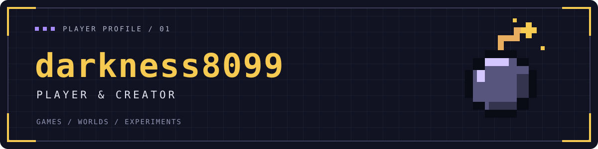

### 👋 你好，我是 SayoMako

喜欢游戏，也想亲手做出值得玩的世界。  
正在探索 **AI 辅助创作 · 游戏机制 · Godot 开发**。

[💣 街机时间](#arcade) · [🎮 正在制作](#creating) · [🧭 探索方向](#exploring)

---

## 💣 ARCADE TIME

把日常的开发足迹，变成一局 Bomberman。

<picture>
  <source media="(prefers-color-scheme: dark)" srcset="https://raw.githubusercontent.com/darkness8099/darkness8099/refs/heads/output/bomberman-contribution-graph-dark.svg">
  <source media="(prefers-color-scheme: light)" srcset="https://raw.githubusercontent.com/darkness8099/darkness8099/refs/heads/output/bomberman-contribution-graph.svg">
  
</picture>

每日更新 · 随 GitHub 深浅主题切换 · 动画由 <a href="https://github.com/abozanona/pacman-contribution-graph">Arcade Contribution Graph</a> 生成

## 🎮 NOW CREATING

### ⛏️ What Did I Do to Deserve This, My Lord? Re

从一只魔物、一段地下通道开始，重新探索受《勇者别嚣张》启发的游戏世界。

**当前进展** · 魔物动画、格子地图、挖掘与基础交互实验。  
**希望走向** · 挖掘改变空间，生态孕育魔物，魔物抵御勇者。

[**进入项目 →**](https://github.com/darkness8099/What-Did-I-Do-to-Deserve-This-My-Lord-Re)

## 🧭 NEXT QUEST

- 🪱 **让生物活起来** — 形象、动作与生态职责相互呼应。
- 🧱 **让机制产生故事** — 从小规模实验，逐步构建可以干预的地下生态。
- 🤖 **探索 AI 协作** — 让 AI 持续制作与验证，用实际游玩决定下一步。

---

**🕹️ KEEP PLAYING · KEEP CREATING**

玩有趣的游戏，做自己的尝试。

